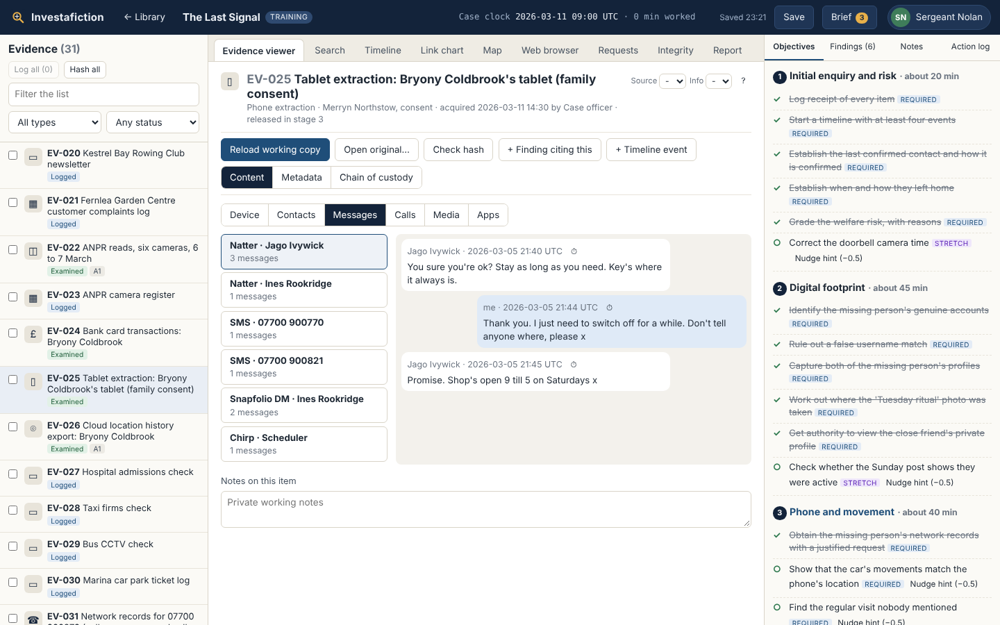
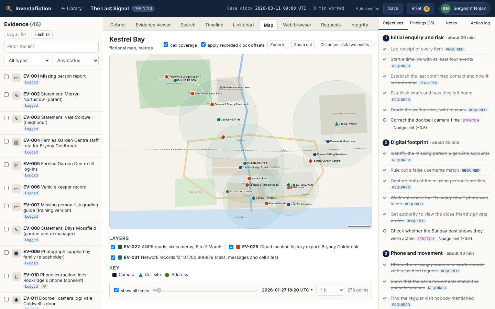
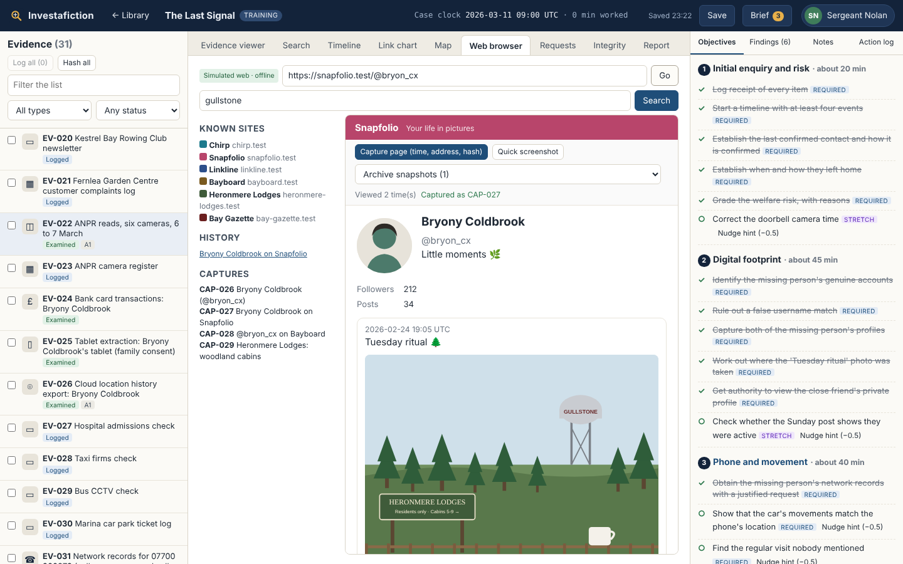
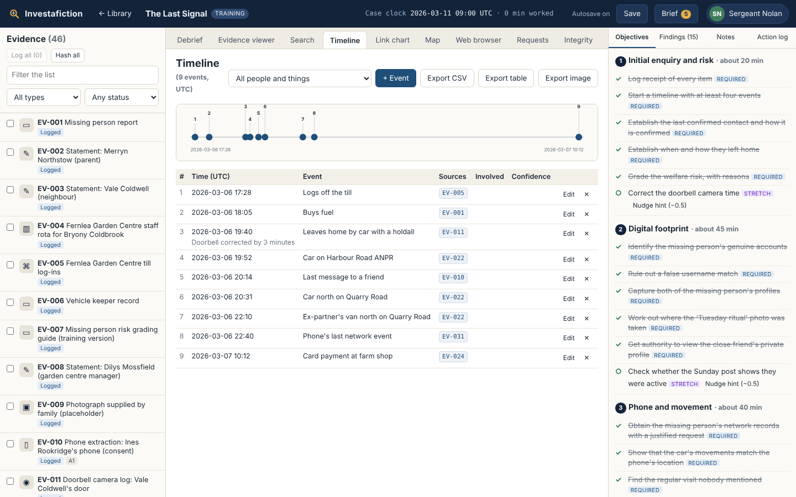
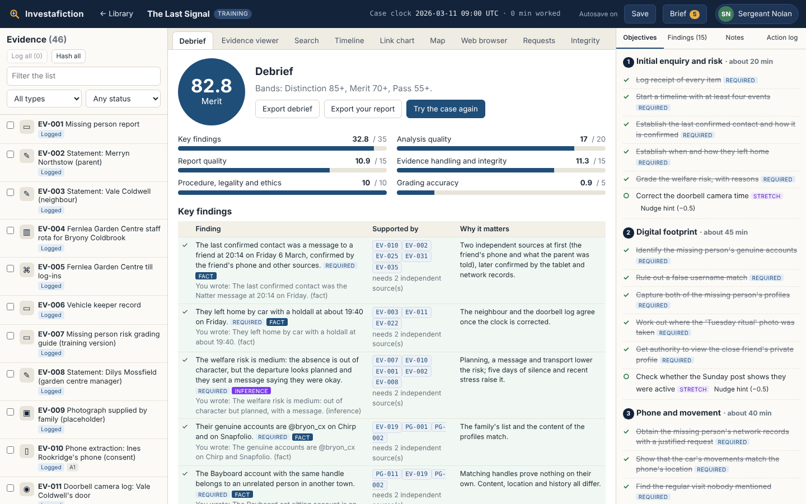

# Investafiction

A desktop investigation simulator. You take the role of an analyst, work a fictional case from the first brief to a written report, and are marked on both your answer and the method you used to reach it.

Investafiction runs fully offline. Cases are separate packs, so anyone can write and share their own.

> **Not official training.** Investafiction is a personal project inspired by investigative methods. It is not endorsed by, approved by or used by any organisation. The legal and procedural rules inside it are simplified and fictional, and nothing in it is legal advice. Every person, business, place and piece of data in the cases is invented.



| | |
|---|---|
|  |  |
|  |  |

## What you do in a case

1. **Import** a `.invcase` pack. The app checks it before anything is added to your library.
2. **Read the brief** and acknowledge your scope and authorities.
3. **Triage.** Log receipt of each item, check its hash, decide what to examine first.
4. **Analyse** in the viewers and tools: search, timeline, link chart, map and a simulated web browser.
5. **Record findings** as facts, inferences or assumptions, each linked to evidence and graded.
6. **Report.** Complete the legality, necessity and proportionality statement and write the report.
7. **Debrief.** See your score, what you found and missed, and any procedural slips.

Each case runs in five or six stages. New material and a message from the case lead arrive as you meet each stage's objectives. Some material only arrives if you submit a narrow, justified request.

## Features

| Area | What is included |
|---|---|
| Evidence viewers | Tables for bank, call, ANPR and log data; message threads for phone extractions; email header panels; documents with metadata; images with metadata; file system listings |
| Analysis tools | Full text search with filters, timeline builder with clock offset handling, link chart with data-driven suggestions, offline fictional map with a time slider, distance tool and cell coverage |
| Evidence handling | Read-only originals, working copies, reasons recorded for any access to an original, chain of custody per item, automatic action log, SHA-256 integrity checker |
| Intelligence | Source reliability (A to E) and information confidence (1 to 5) grading on items and findings |
| OSINT | Simulated platforms with public and private profiles, simulated search with near misses, archive snapshots, image clues and proper page capture with time, address and hash |
| Procedure | Requests for data and authority, procedural traps, training mode with three levels of hint and warnings, assessment mode with feedback only at the end |
| Output | Structured report builder with a citation check, PDF and Markdown export, a detailed debrief |
| Profile | Choose one of three preset names on first launch (Officer Smith, Detective Jones or Sergeant Nolan). Cosmetic only, shown in the top bar and on the report sign-off |

## Starter pack

| Case | Specialty | Difficulty | Time | Items | Stages | Findings (required / stretch) |
|---|---|---|---|---|---|---|
| The Ledger | Financial crime | Beginner | about 2 hours | 45 | 5 | 12 / 4 |
| The Last Signal | OSINT and missing person enquiry | Intermediate | about 2.5 hours | 47 items and 20 web pages | 5 | 16 / 6 |
| Quiet Exit | Digital forensics and data theft | Hard | about 3.5 hours | 89 items and 4 web pages | 6 | 24 / 8 |

The built packs are in [`packs/dist`](packs/dist). Every case can be saved and resumed, and each stage break is a natural place to stop.

## Install

Download an installer for Windows, macOS or Linux from the Releases page, run it, then choose **Import case pack** and pick a file from `packs/dist`.

## Build from source

You need Rust (stable), Node.js 20 or later and Python 3.10 or later. On Linux you also need the WebKitGTK development packages that Tauri uses (`libwebkit2gtk-4.1-dev`, `libgtk-3-dev`, `librsvg2-dev`).

```bash
# 1. Case packs (optional, they are already built in packs/dist)
pip install -r tools/requirements.txt
PYTHONPATH=tools python -m invtools build-all

# 2. Desktop app
cd app
npm install
npm run tauri dev      # run in development
npm run tauri build    # build an installer
```

### Browser development mode

The interface can also run in a normal browser against the same Rust core, which is handy for quick interface work:

```bash
cd app && npm run build
cd ../core && cargo run --features devserver --bin invcore-devserver -- ./devdata 8765 ../app/dist
# open http://127.0.0.1:8765
```

## Tests

```bash
cd core && cargo test                         # import security, scoring, full playthroughs of all three cases
PYTHONPATH=tools python -m pytest tests/python   # validator, determinism, safety scan, solvability
cd app && npm run typecheck
```

Every change is built and tested on GitHub before it merges (see `.github/workflows`).

## How it is built

| Layer | Language | Job |
|---|---|---|
| Interface | React and TypeScript | Every screen |
| Core | Rust (`core/`) | Opening and verifying packs, hashing, the read-only evidence store, saves, the action log, traps, requests and scoring. The answer key stays here until the report is submitted |
| Desktop shell | Tauri (`app/src-tauri`) | A small native window with one command into the core. No network plugins |
| Authoring tools | Python (`tools/`) | Schema validator, case builder, seeded data generators, solvability and synthetic data checks |
| Contract | JSON Schema (`schemas/`) | Shared by every layer |

Read more in [docs/DESIGN.md](docs/DESIGN.md).

## Write your own case

See the [authoring guide](docs/AUTHORING.md). In short: `python -m invtools new my-case`, write the story script, build, then import the `.invcase` file. The [synthetic data rules](docs/SYNTHETIC_DATA.md) must be followed for every case.

## Standards the design follows

The design borrows ideas from the four digital evidence principles published for UK policing and from the National Intelligence Model, and turns them into things the player has to do. It does not copy either document and does not describe real procedure. See [docs/STANDARDS.md](docs/STANDARDS.md), which links to the official published material.

## Licence

Investafiction is **source available and free to share**, not open source in the strict sense, because commercial use is not allowed.

- Code: [PolyForm Noncommercial 1.0.0](LICENSE)
- Case content, images and documentation: [CC BY-NC-SA 4.0](LICENSE-CONTENT.md)

You may share and adapt the work for non-commercial purposes. See [CONTRIBUTING.md](CONTRIBUTING.md) for how contributions are licensed.
